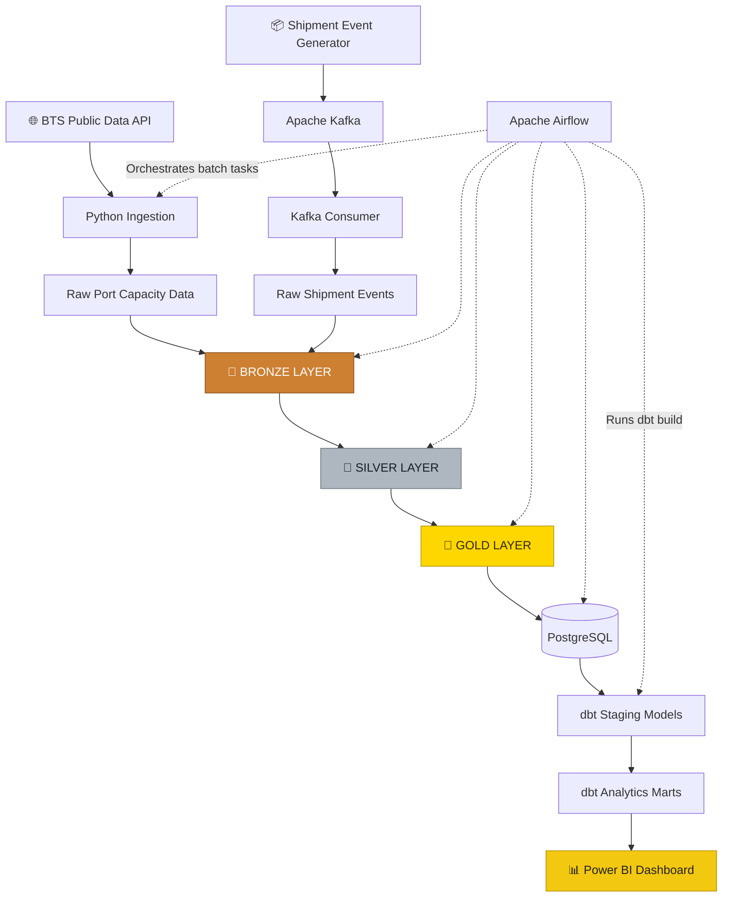
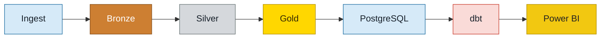
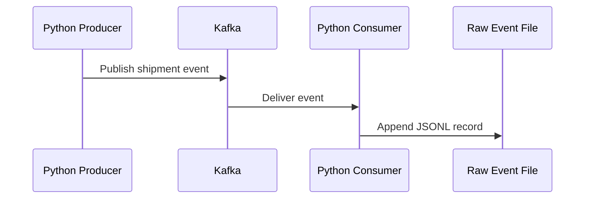

# 🚢 Shipping Data Engineering & Analytics Platform

<p align="center">
  <strong>An End-to-End Data Engineering Platform for Shipping & Logistics Analytics</strong>
</p>

<p align="center">
  
  
  
  
  
  
  
  
</p>

---

## 📌 Project Overview

This project demonstrates an end-to-end data engineering workflow for shipping and logistics analytics. It combines data ingestion, data quality validation, multi-layer data processing, workflow orchestration, SQL-based transformations, and interactive business intelligence.

The platform follows the **Medallion Architecture — Bronze, Silver, and Gold** — to organize raw data, cleaned datasets, and business-ready analytical outputs.

### 🎯 Project Objectives

* Build a structured pipeline for shipping and transportation data.
* Ingest public transportation data and process shipment-event records.
* Implement Bronze, Silver, and Gold data layers.
* Use Apache Airflow to orchestrate batch-processing tasks.
* Store analytical datasets in PostgreSQL.
* Build staging models and analytical marts with dbt.
* Demonstrate event streaming using Apache Kafka.
* Deliver an interactive Power BI dashboard for exploring logistics indicators.

---

## 🏗️ System Architecture

The following diagram illustrates the major components and how data moves through the platform.



> **Architecture note:** The Kafka producer and consumer form a separate streaming demonstration. Airflow orchestrates the batch workflow and dbt transformations; Kafka is not automatically part of the Airflow batch execution path.

---

## 🥉 Medallion Architecture

The data processing workflow is organized into three layers. Each layer has a distinct responsibility, making the pipeline easier to understand, validate, and maintain.

### 🥉 1. Bronze Layer — Raw Data

**Purpose: Preserve ingested data and maintain traceability.**

The Bronze layer receives source records before analytical cleaning is applied.

**Key responsibilities:**

* Read ingested port-capacity data.
* Process shipment-event records.
* Preserve source fields for downstream processing.
* Add ingestion metadata where implemented, such as load timestamps.
* Keep the raw and processed stages logically separated.

**Main components:**

* `processing/bronze_port_capacity.py`
* `processing/bronze_shipment_events.py`

**Output:** Raw or minimally processed records ready for validation and standardization.

### 🥈 2. Silver Layer — Cleaned & Validated Data

**Purpose: Improve data quality and consistency.**

The Silver layer prepares datasets for reliable analysis.

**Key responsibilities:**

* Standardize column names and data types.
* Parse dates and numeric values.
* Validate required fields and identifiers.
* Identify invalid or incomplete records.
* Apply deduplication rules where appropriate.
* Separate data-quality checks from downstream business aggregation.

**Main components:**

* `processing/silver_port_capacity.py`
* `processing/silver_shipment_events.py`
* `processing/clean_port_capacity.py`
* `processing/process_shipment_events.py`
* `processing/check_shipment_data.py`

**Output:** Cleaned and validated datasets suitable for analytical transformations.

### 🥇 3. Gold Layer — Business-Ready Analytics

**Purpose: Transform validated data into useful analytical outputs.**

The Gold layer prepares curated datasets for PostgreSQL and downstream reporting.

**Port Capacity Analytics**

* Organizes capacity indicators into analytical categories.
* Produces monthly and annual summaries.
* Calculates aggregation metrics such as counts, averages, minimums, and maximums where applicable.
* Preserves measurement units to support meaningful comparisons.

**Shipment Analytics**

* Summarizes shipment-event information.
* Prepares analytical outputs for relational storage and reporting.

**Main components:**

* `processing/gold_port_capacity.py`
* `processing/gold_shipment_summary.py`
* `scripts/load_gold_port_capacity_summary.py`
* `scripts/load_gold_shipment_summary.py`

**Output:** Curated datasets ready for loading, SQL analytics, and visualization.

---

## 🔄 End-to-End Data Flow



### Pipeline Stages

| Stage          | Responsibility                      | Technology                  |
| -------------- | ----------------------------------- | --------------------------- |
| Ingestion      | Retrieve source data                | Python, BTS API             |
| Streaming      | Publish and consume shipment events | Apache Kafka                |
| Bronze         | Preserve incoming records           | Python / PySpark processing |
| Silver         | Clean and validate data             | Python / PySpark processing |
| Gold           | Create analytical summaries         | Python / PySpark processing |
| Storage        | Store analytical datasets           | PostgreSQL                  |
| Transformation | Build staging models and marts      | dbt Core                    |
| Orchestration  | Coordinate batch-processing tasks   | Apache Airflow              |
| Visualization  | Explore indicators and summaries    | Power BI                    |

---

## ⚙️ Workflow Orchestration — Apache Airflow

The project includes an Airflow DAG:

`airflow/dags/shipping_pipeline.py`

The DAG coordinates the main batch workflow, including data ingestion, processing stages, database loading, and dbt execution.

The intended workflow is:

1. Fetch port-capacity data.
2. Process port-capacity records through the relevant Bronze, Silver, and Gold tasks.
3. Process shipment-event data through the relevant processing tasks.
4. Load analytical outputs into PostgreSQL.
5. Run dbt models and tests using `dbt build`.

The Kafka producer and consumer are separate processes and can be run independently for the streaming demonstration.

---

## 🗄️ Data Warehouse & Analytics — PostgreSQL + dbt

PostgreSQL acts as the relational storage layer for analytical outputs.

dbt Core organizes SQL transformations into staging models and marts.

### Staging Models

* `stg_port_capacity`
* `stg_shipment_events`

Staging models provide a consistent interface to source tables and prepare fields for downstream analysis.

### Analytical Marts

* `mart_port_capacity`
* `mart_shipment_summary`

These models expose curated datasets for analytical queries and Power BI reporting.

The project also includes dbt model configuration and documentation files under `shipping_analytics/models/`.

---

## 📡 Streaming Demonstration — Apache Kafka

The project includes a Kafka producer and consumer for demonstrating event-driven data ingestion.

**Producer:** `streaming/producer.py`
Generates simulated shipment-event messages.

**Consumer:** `streaming/consumer.py`
Reads messages from Kafka and writes the consumed events to a local JSONL file.



> Shipment events generated by the producer are synthetic demonstration data. They do not represent verified live carrier tracking.

---

## 📊 Power BI Dashboard

The repository includes the Power BI report:

**`shimpent dashbord.pbix`**

The dashboard contains five pages:

| Page                  | Purpose                                 |
| --------------------- | --------------------------------------- |
| 🏠 Welcome            | Project introduction and navigation     |
| 📈 Executive Overview | High-level analytical overview          |
| ⚓ Port Capacity       | Port-capacity indicators and trends     |
| 📦 Shipment Tracking  | Shipment-event exploration              |
| 🔎 Data Explorer      | Detailed data exploration and filtering |

The report is designed to help users explore the prepared data interactively through KPI cards, charts, and filters.

**Open the report:** [Shipping Power BI Dashboard](./shimpent%20dashbord.pbix)

---

## 🧰 Technology Stack

| Technology              | Role in the Project                                 |
| ----------------------- | --------------------------------------------------- |
| Python                  | Ingestion scripts, processing, and event generation |
| PySpark / Apache Spark  | Distributed data processing components              |
| Apache Kafka            | Shipment-event streaming demonstration              |
| PostgreSQL              | Relational storage for analytical data              |
| dbt Core                | SQL transformations, staging models, and marts      |
| Apache Airflow          | Batch workflow orchestration                        |
| Docker & Docker Compose | Local service setup                                 |
| Power BI                | Interactive data visualization                      |
| Git & GitHub            | Version control and project documentation           |

---

## 📁 Repository Structure

```text
shipping-data-engineering/
│
├── airflow/
│   ├── dags/
│   │   └── shipping_pipeline.py
│   └── dbt_profiles/
│       └── profiles.yml
│
├── ingestion/
│   └── fetch_port_capacity.py
│
├── processing/
│   ├── bronze_port_capacity.py
│   ├── bronze_shipment_events.py
│   ├── silver_port_capacity.py
│   ├── silver_shipment_events.py
│   ├── gold_port_capacity.py
│   ├── gold_shipment_summary.py
│   ├── load_port_capacity.py
│   ├── load_shipment_events.py
│   └── check_shipment_data.py
│
├── scripts/
│   ├── load_gold_port_capacity_summary.py
│   └── load_gold_shipment_summary.py
│
├── shipping_analytics/
│   ├── models/
│   │   ├── staging/
│   │   └── marts/
│   └── dbt_project.yml
│
├── sql/
│   └── shipping_indicators.sql
│
├── streaming/
│   ├── producer.py
│   └── consumer.py
│
├── docker-compose.yml
├── docker-compose.airflow.yml
├── Dockerfile.airflow
├── requirements.txt
├── README.md
└── shimpent dashbord.pbix
```

---

## 🚀 Getting Started

### Prerequisites

* Python
* Docker and Docker Compose
* Git
* Power BI Desktop (to open the dashboard)
* API access/configuration required by the ingestion script

### 1. Clone the Repository

```bash
git clone https://github.com/ali1234554321t-cpu/shipping-data-engineering.git
cd shipping-data-engineering
```

### 2. Configure Environment Variables

Create a local `.env` file based on the example template, if provided:

```bash
cp .env.example .env
```

Replace all placeholders with local configuration values. Never commit real passwords, tokens, or private keys.

### 3. Install Python Dependencies

```bash
python3 -m venv .venv
source .venv/bin/activate
pip install -r requirements.txt
```

### 4. Start the Local Services

Use the appropriate Docker Compose configuration and environment variables for the services you want to run. Check the Compose configuration and project setup before starting services.

### 5. Run the Pipeline

Start with the ingestion script, ensure the source data and required services are available, then run the relevant processing and loading steps. The Airflow DAG can be used to orchestrate the configured batch workflow.

### 6. Run dbt

From the dbt project directory, configure the matching profile and database connection, then execute:

```bash
dbt build
```

### 7. Open the Power BI Report

Open `shimpent dashbord.pbix` in Power BI Desktop. Configure the appropriate local data connection if required.

---

## 🔐 Data & Security Notes

* Do not commit `.env` files, database passwords, API tokens, or private credentials.
* Raw datasets and generated artifacts may be excluded from Git to keep the repository lightweight.
* Port-capacity data is obtained from a public transportation data source.
* Shipment events produced by the Kafka demonstration are synthetic.
* Actual dashboard results depend on the available data, successful pipeline execution, and database configuration.
* The project is a learning and portfolio platform, not a production-certified shipment tracking service.

---

## 👨‍💻 Author

**Ali Rabea Ahmed**

Data Engineering | Python | SQL | PySpark | PostgreSQL | dbt | Apache Airflow | Apache Kafka | Power BI

GitHub: [ali1234554321t-cpu](https://github.com/ali1234554321t-cpu)

---

<p align="center">
  <strong>From Raw Data to Business Insights 🚢</strong>
</p>
